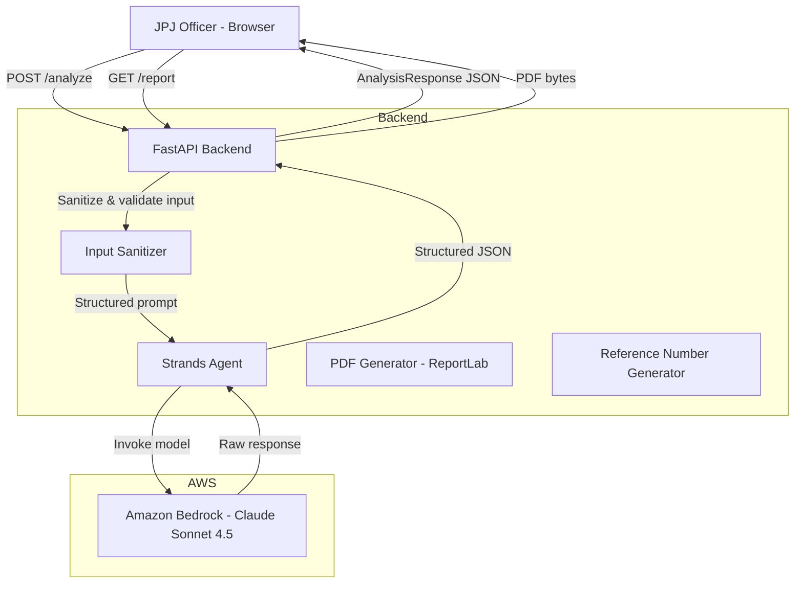

# Design Document: JPJ Traffic & Walkability AI Advisor

## Overview

The JPJ Traffic & Walkability AI Advisor is a stateless, bilingual (Bahasa Malaysia / English) web-based decision-support system for Jabatan Pengangkutan Jalan (JPJ) officers. The system accepts structured input (location dropdown, conditions dropdowns, constraints free-text) and uses an AI agent powered by Amazon Bedrock (Claude Sonnet 4.5) via the Strands Agents SDK to generate structured, actionable recommendations across four categories. Results are displayed on a React dashboard with an interactive Leaflet.js map, priority-coded recommendation cards, and a downloadable government-style PDF report.

The system is intentionally stateless — no data is persisted between sessions. Each request-response cycle is self-contained, and a unique reference number is generated in-memory per session.

### Key Design Goals

- **Stateless by design**: No database, no file system writes, no session storage.
- **Structured AI output**: The agent returns a validated JSON schema, not free-form text.
- **Constraint-aware recommendations**: All recommendations are filtered against extracted constraints before output.
- **Bilingual formal tone**: All recommendation text uses formal Bahasa Malaysia / English.
- **Downloadable PDF**: Government-style report generated server-side on demand.

---

## Architecture

The system follows a three-tier architecture: React frontend → FastAPI backend → Strands Agent (Amazon Bedrock).



### Request Flow

1. The JPJ Officer selects a location from the dropdown, sets conditions, and optionally enters constraints.
2. The React Dashboard sends a `POST /analyze` request with `location`, `location_context`, `conditions`, and `constraints`.
3. FastAPI sanitizes all input fields (strip HTML, control characters, prompt-injection patterns; truncate at 2,000 chars).
4. FastAPI generates a unique reference number in-memory and invokes the Strands Agent with a structured system prompt.
5. The Strands Agent calls Claude Sonnet 4.5 via Amazon Bedrock, extracts constraints, generates recommendations, validates them against constraints, and returns a structured JSON object.
6. FastAPI validates the agent output against the `AnalysisResponse` Pydantic schema and returns it to the Dashboard.
7. When the officer clicks "Download PDF Report", the Dashboard calls `POST /report` with the current analysis payload; FastAPI generates the PDF using ReportLab and streams it back.

---

## Components and Interfaces

### Frontend Components (React)

```
src/
├── App.tsx                        # Root component, layout
├── components/
│   ├── Header.tsx                 # JPJ logo placeholder + bilingual title
│   ├── InputForm.tsx              # Location dropdown, conditions, constraints
│   ├── SummaryBanner.tsx          # Location, conditions, constraint tags
│   ├── MapPanel.tsx               # Leaflet.js map with pin + overlays
│   ├── RecommendationPanel.tsx    # Four category sections with cards
│   ├── RecommendationCard.tsx     # Single card: action, party, timeline, badge
│   └── PdfDownloadButton.tsx      # Triggers PDF download
├── hooks/
│   └── useAnalysis.ts             # API call logic, loading/error state
├── constants/
│   └── locations.ts               # Pre-defined location options + context strings
└── types/
    └── api.ts                     # TypeScript types mirroring backend schemas
```

#### Key Component Interfaces

**InputForm props:**
```typescript
interface InputFormProps {
  onSubmit: (payload: AnalyzeRequest) => void;
  isLoading: boolean;
}
```

**MapPanel props:**
```typescript
interface MapPanelProps {
  location: LocationOption | null;
  recommendations: Recommendations | null;
  highlightedCategory: RecommendationCategory | null;
  onOverlayClick: (category: RecommendationCategory) => void;
}
```

**RecommendationCard props:**
```typescript
interface RecommendationCardProps {
  recommendation: Recommendation;
  isHighlighted: boolean;
}
```

### Backend Components (FastAPI / Python)

```
backend/
├── main.py                        # FastAPI app, route definitions
├── models.py                      # Pydantic request/response schemas
├── sanitizer.py                   # Input sanitization logic
├── agent.py                       # Strands Agent initialization + invocation
├── pdf_generator.py               # ReportLab PDF generation
└── reference.py                   # In-memory reference number generation
```

#### API Endpoints

| Method | Path | Description |
|--------|------|-------------|
| `POST` | `/analyze` | Accept input, invoke agent, return structured JSON |
| `POST` | `/report` | Accept analysis payload, return PDF as `application/pdf` |

**POST /analyze — Request Body:**
```json
{
  "location": "Jalan Templer, Kuala Lumpur",
  "location_context": "Residential-commercial mix, school zones...",
  "conditions": {
    "weather": "Hujan Lebat / Heavy Rain",
    "time_of_day": "Waktu Puncak Pagi / Morning Peak",
    "event_type": "Hari Persekolahan / School Day"
  },
  "constraints": "Bajet terhad RM500,000. Tiada kerja jalan raya semasa waktu sekolah."
}
```

**POST /analyze — Response Body:**
```json
{
  "reference_number": "JPJ-20240715-A3F9",
  "summary": "...",
  "location_context": "...",
  "conditions_applied": {...},
  "constraints_applied": ["Budget limit: RM500,000", "No roadworks during school hours"],
  "recommendations": {
    "traffic_flow": [...],
    "public_transport": [...],
    "walkability": [...],
    "policy_enforcement": [...]
  },
  "risk_assessment": "...",
  "priority_actions": [...]
}
```

**Recommendation object:**
```json
{
  "action": "Laraskan masa isyarat di persimpangan utama / Adjust signal timing at main intersection",
  "responsible_party": "JPJ / DBKL",
  "estimated_timeline": "2-4 minggu / 2-4 weeks",
  "priority_level": "Critical"
}
```

---

## Data Models

### Pydantic Models (Backend)

```python
from pydantic import BaseModel, Field
from typing import Literal, Optional
from enum import Enum

class PriorityLevel(str, Enum):
    CRITICAL = "Critical"
    HIGH = "High"
    MEDIUM = "Medium"

class Conditions(BaseModel):
    weather: str = ""
    time_of_day: str = ""
    event_type: str = ""

class AnalyzeRequest(BaseModel):
    location: str
    location_context: str
    conditions: Conditions
    constraints: str = ""

class Recommendation(BaseModel):
    action: str
    responsible_party: str
    estimated_timeline: str
    priority_level: PriorityLevel

class Recommendations(BaseModel):
    traffic_flow: list[Recommendation]
    public_transport: list[Recommendation]
    walkability: list[Recommendation]
    policy_enforcement: list[Recommendation]

class AnalysisResponse(BaseModel):
    reference_number: str
    summary: str
    location_context: str
    conditions_applied: Conditions
    constraints_applied: list[str]
    recommendations: Recommendations
    risk_assessment: str
    priority_actions: list[str]

class ReportRequest(BaseModel):
    analysis: AnalysisResponse
```

### TypeScript Types (Frontend)

```typescript
export type PriorityLevel = "Critical" | "High" | "Medium";
export type RecommendationCategory =
  | "traffic_flow"
  | "public_transport"
  | "walkability"
  | "policy_enforcement";

export interface Recommendation {
  action: string;
  responsible_party: string;
  estimated_timeline: string;
  priority_level: PriorityLevel;
}

export interface Recommendations {
  traffic_flow: Recommendation[];
  public_transport: Recommendation[];
  walkability: Recommendation[];
  policy_enforcement: Recommendation[];
}

export interface AnalysisResponse {
  reference_number: string;
  summary: string;
  location_context: string;
  conditions_applied: Conditions;
  constraints_applied: string[];
  recommendations: Recommendations;
  risk_assessment: string;
  priority_actions: string[];
}
```

### Pre-Defined Location Data (Frontend Constant)

```typescript
export const LOCATIONS: LocationOption[] = [
  {
    value: "Jalan Templer, Kuala Lumpur",
    label: "Jalan Templer, Kuala Lumpur",
    context:
      "Residential-commercial mix, school zones, narrow road, morning peak congestion toward KL city centre. Known bottlenecks at school drop-off points between 7:00–8:30 AM.",
    coordinates: [3.1685, 101.6505],
  },
  {
    value: "Jalan Ampang, Kuala Lumpur",
    label: "Jalan Ampang, Kuala Lumpur",
    context:
      "Embassy corridor, KLCC proximity, event traffic from Stadium Merdeka area, high pedestrian activity. Frequent VIP convoy disruptions and diplomatic traffic.",
    coordinates: [3.1579, 101.7151],
  },
  {
    value: "Petaling Jaya / Subang Jaya",
    label: "Petaling Jaya / Subang Jaya",
    context:
      "Suburban sprawl, LRT connectivity gaps, SS2 / USJ commercial zones, heavy cross-district commuter flow. High dependency on private vehicles due to last-mile transit gaps.",
    coordinates: [3.1073, 101.6067],
  },
];
```

### Reference Number Format

Reference numbers are generated in-memory using the pattern `JPJ-{YYYYMMDD}-{4-char hex}`, e.g. `JPJ-20240715-A3F9`. Generated using Python's `uuid4()` hex prefix combined with the current UTC date. No persistence.

---

## Strands Agent Design

### Agent Initialization

The Strands Agent is initialized once at FastAPI startup using `BedrockModel` with Claude Sonnet 4.5:

```python
from strands import Agent
from strands.models import BedrockModel

bedrock_model = BedrockModel(
    model_id="us.anthropic.claude-sonnet-4-5-20251001-v1:0",
    region_name="us-east-1",
    temperature=0.3,
)

SYSTEM_PROMPT = """
You are a bilingual (Bahasa Malaysia / English) traffic and walkability advisor for
Jabatan Pengangkutan Jalan (JPJ) Malaysia. You generate structured, actionable
recommendations for JPJ officers based on location context, conditions, and constraints.

Rules:
1. Extract all constraints (budget limits, policy restrictions, jurisdiction scope) from the constraints field.
2. Generate recommendations ONLY for the four categories: traffic_flow, public_transport, walkability, policy_enforcement.
3. Assign each recommendation a priority_level of exactly: Critical, High, or Medium.
4. Validate every recommendation against extracted constraints. Exclude any that violate constraints.
5. List excluded recommendations in constraints_applied with reason.
6. Use formal bilingual tone (Bahasa Malaysia / English) in all recommendation text.
7. Return ONLY valid JSON matching the specified schema. No markdown, no prose outside JSON.
"""

advisor_agent = Agent(
    model=bedrock_model,
    system_prompt=SYSTEM_PROMPT,
    callback_handler=None,
)
```

### Structured Output Strategy

The agent is invoked with a prompt that includes the full JSON schema and instructs the model to return only valid JSON. The response text is parsed with `json.loads()` and validated against the `AnalysisResponse` Pydantic model. If parsing or validation fails, the endpoint returns HTTP 500.

```python
async def invoke_advisor(request: AnalyzeRequest, reference_number: str) -> AnalysisResponse:
    prompt = build_prompt(request, reference_number)
    result = await advisor_agent.invoke_async(prompt)
    raw_text = str(result.message["content"][0]["text"])
    data = json.loads(raw_text)
    return AnalysisResponse(**data)
```

---

## Map Design (Leaflet.js)

### Location Coordinates

Each pre-defined location has a fixed coordinate pair used to center the map and place the pin marker.

### Overlay Strategy

Each recommendation category is represented by a colored circle overlay centered on the location pin, with a radius offset to avoid overlap:

| Category | Color | Offset |
|---|---|---|
| `traffic_flow` | Red | North |
| `public_transport` | Blue | East |
| `walkability` | Green | South |
| `policy_enforcement` | Orange | West |

Clicking an overlay dispatches a `categorySelected` event that scrolls the right panel to the corresponding recommendation section and applies a highlight class.

### Map Initialization

```typescript
// Default: Malaysia center, zoom 12 for city-level view
const DEFAULT_CENTER: LatLngTuple = [3.1390, 101.6869]; // Kuala Lumpur
const DEFAULT_ZOOM = 12;
```

---

## PDF Report Design (ReportLab)

The PDF is generated server-side using [ReportLab](https://www.reportlab.com/) (`reportlab` Python package). The report uses ReportLab's Platypus layout engine for structured, multi-page documents.

### Report Structure

1. **Header** — JPJ logo placeholder (grey rectangle), report title "Laporan Analisis Trafik dan Kemudahan Pejalan Kaki", date (DD/MM/YYYY), reference number
2. **Executive Summary** — `summary` field from response
3. **Location & Conditions** — location name, location context, conditions applied
4. **Constraints Applied** — bulleted list of extracted constraints
5. **Traffic Flow Recommendations** — table with action, responsible party, timeline, priority badge
6. **Public Transport Recommendations** — same table format
7. **Walkability Recommendations** — same table format
8. **Policy/Enforcement Actions** — same table format
9. **Risk Assessment** — `risk_assessment` field

### Priority Badge Colors (PDF)

| Priority | Background Color |
|---|---|
| Critical | `#DC2626` (red) |
| High | `#D97706` (amber) |
| Medium | `#2563EB` (blue) |

### Footer

Every page includes the footer: *"Laporan ini dijana oleh sistem AI JPJ — untuk kegunaan dalaman sahaja"*

### PDF Endpoint

`POST /report` accepts the full `AnalysisResponse` JSON, generates the PDF in-memory using `io.BytesIO`, and returns it as a streaming response with `Content-Type: application/pdf` and `Content-Disposition: attachment; filename="JPJ-Report-{reference_number}.pdf"`. No file is written to disk.

---

## Input Sanitization Design

The `sanitizer.py` module applies the following transformations server-side to `location`, `conditions.*`, and `constraints` fields:

1. **Strip HTML tags** — regex `<[^>]+>` → `""`
2. **Strip control characters** — regex `[\x00-\x1f\x7f]` → `""`
3. **Strip prompt-injection patterns** — remove sequences matching patterns like `ignore previous instructions`, `system:`, `<|im_start|>`, `###`, `---` at line start
4. **Truncate to 2,000 characters** — if any field exceeds 2,000 chars after sanitization, truncate and set `truncated: true` in response warning

The sanitized values replace the originals before being passed to the agent. The Dashboard is not relied upon for sanitization.

---

## Error Handling

| Scenario | Backend Behavior | Frontend Behavior |
|---|---|---|
| Missing required field (`location`) | HTTP 422 with Pydantic validation error JSON | Display field-level validation error |
| Agent invocation fails (Bedrock error) | HTTP 500 with `{"error": "Agent invocation failed: ..."}` | Display error notification banner |
| Agent returns unparseable JSON | HTTP 500 with `{"error": "Failed to parse agent response"}` | Display error notification banner |
| Agent response fails Pydantic validation | HTTP 500 with `{"error": "Invalid agent response schema"}` | Display error notification banner |
| PDF generation fails | HTTP 500 with `{"error": "PDF generation failed: ..."}` | Display error notification on download button |
| Input field truncated | HTTP 200 with `warnings: ["constraints field truncated to 2000 characters"]` | Display inline warning near constraints field |
| No location selected on submit | N/A (client-side validation) | Display "Sila pilih lokasi / Please select a location" error |

---

## Testing Strategy

### Unit Tests (pytest)

Unit tests cover the pure logic layers:

- **`sanitizer.py`**: Test HTML stripping, control character removal, prompt-injection pattern removal, truncation at exactly 2,000 characters, truncation warning flag.
- **`reference.py`**: Test reference number format matches `JPJ-{YYYYMMDD}-{4-char hex}`, uniqueness across multiple calls.
- **`models.py`**: Test Pydantic validation — valid payloads pass, missing fields raise `ValidationError`, invalid `priority_level` values raise `ValidationError`.
- **`pdf_generator.py`**: Test that PDF bytes are non-empty, that the output is a valid PDF (starts with `%PDF`), that all required sections are present (mock the analysis response).

### Property-Based Tests (Hypothesis)

Property-based tests use the [Hypothesis](https://hypothesis.readthedocs.io/) library (Python). Each test runs a minimum of 100 iterations.

See **Correctness Properties** section for the full list of properties. Each property test is tagged:

> **Feature: jpj-traffic-walkability-advisor, Property {N}: {property_text}**

### Integration Tests

- **Agent integration**: Test that a real invocation of the Strands Agent with a valid prompt returns a parseable `AnalysisResponse`. Run with 2–3 representative location/condition combinations. Requires AWS credentials.
- **API integration**: Test `POST /analyze` end-to-end with a mocked Strands Agent, verifying HTTP 200 and correct response schema.
- **PDF endpoint**: Test `POST /report` returns `Content-Type: application/pdf` and non-empty bytes.

### Frontend Tests (Vitest + React Testing Library)

- **InputForm**: Test that submitting without a location shows validation error; test that selecting a location populates `location_context`.
- **RecommendationCard**: Test that Critical cards render with red class, High with amber, Medium with blue.
- **SummaryBanner**: Test that constraint tags render as distinct elements.
- **MapPanel**: Test that clicking an overlay calls `onOverlayClick` with the correct category.

---

## Correctness Properties

*A property is a characteristic or behavior that should hold true across all valid executions of a system — essentially, a formal statement about what the system should do. Properties serve as the bridge between human-readable specifications and machine-verifiable correctness guarantees.*

The following properties are derived from the acceptance criteria. Property-based tests use the [Hypothesis](https://hypothesis.readthedocs.io/) library (Python) for backend properties and [fast-check](https://fast-check.dev/) for frontend properties. Each test runs a minimum of 100 iterations.

---

### Property 1: Sanitizer removes all disallowed content

*For any* string containing HTML tags, control characters (ASCII 0x00–0x1F, 0x7F), or prompt-injection patterns (e.g. "ignore previous instructions", "system:", `<|im_start|>`), running it through the sanitizer SHALL produce an output string that contains none of those patterns.

**Validates: Requirements 2.1**

---

### Property 2: Sanitizer truncates long inputs

*For any* string whose length exceeds 2,000 characters, running it through the sanitizer SHALL produce an output string of length at most 2,000 characters, and the sanitizer SHALL set a truncation warning flag.

**Validates: Requirements 2.2**

---

### Property 3: Every recommendation is structurally valid

*For any* recommendation object, it SHALL contain all four required fields (`action`, `responsible_party`, `estimated_timeline`, `priority_level`) as non-empty strings, and `priority_level` SHALL be exactly one of `Critical`, `High`, or `Medium`.

**Validates: Requirements 4.2, 4.3**

---

### Property 4: Analysis response contains all required top-level fields

*For any* valid `AnalysisResponse` object, it SHALL contain all required top-level fields: `reference_number`, `summary`, `location_context`, `conditions_applied`, `constraints_applied`, `recommendations`, `risk_assessment`, and `priority_actions`, and none of these fields SHALL be null.

**Validates: Requirements 5.1**

---

### Property 5: Recommendation cards are color-coded by priority

*For any* recommendation object with a given `priority_level`, rendering it as a `RecommendationCard` SHALL produce a card element that applies the correct color scheme: red for `Critical`, amber for `High`, and blue for `Medium`.

**Validates: Requirements 7.1**

---

### Property 6: Recommendation cards display all required fields

*For any* recommendation object, rendering it as a `RecommendationCard` SHALL produce a card element whose text content includes the `action`, `responsible_party`, `estimated_timeline`, and `priority_level` values.

**Validates: Requirements 7.3**

---

### Property 7: Recommendation cards are sorted by priority within each category

*For any* list of recommendations with mixed priority levels, the rendered order within each category section SHALL always place `Critical` cards before `High` cards, and `High` cards before `Medium` cards.

**Validates: Requirements 7.4**

---

### Property 8: Summary banner renders one tag per constraint

*For any* list of N constraint strings (N ≥ 0), rendering the `SummaryBanner` with those constraints SHALL produce exactly N distinct constraint tag elements in the banner.

**Validates: Requirements 8.2**

---

### Property 9: PDF report contains all required sections and priority badges

*For any* valid `AnalysisResponse` object, generating a PDF report from it SHALL produce a non-empty PDF (starting with `%PDF`) whose byte content includes all required section headers ("Laporan Analisis Trafik", "Executive Summary", "Constraints Applied", "Traffic Flow", "Public Transport", "Walkability", "Policy/Enforcement", "Risk Assessment") and the priority level text for every recommendation, and the footer text "Laporan ini dijana oleh sistem AI JPJ — untuk kegunaan dalaman sahaja".

**Validates: Requirements 9.2, 9.3, 9.4**

---

### Property 10: Reference numbers are unique across sessions

*For any* N ≥ 2 calls to the reference number generator, all N generated reference numbers SHALL be distinct (no two calls produce the same value), and each SHALL match the format `JPJ-{YYYYMMDD}-{4-char hex}`.

**Validates: Requirements 9.5**
